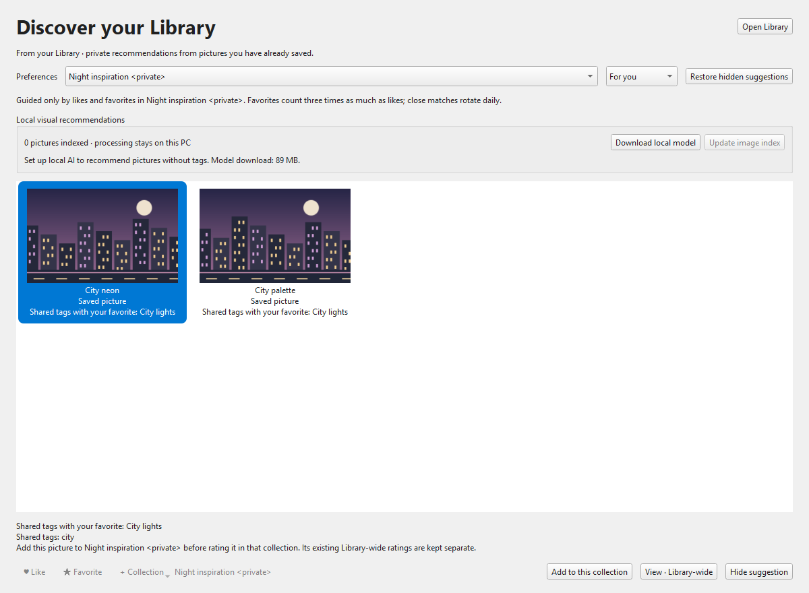
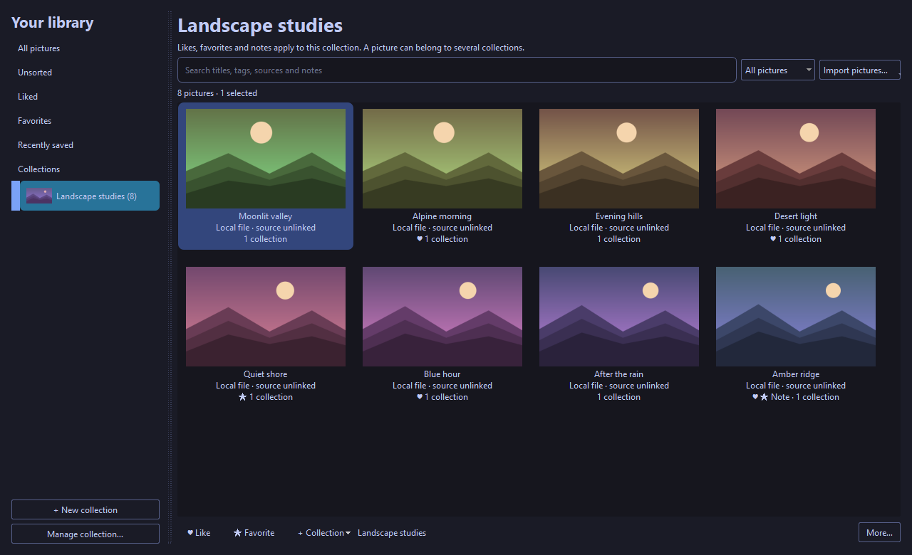
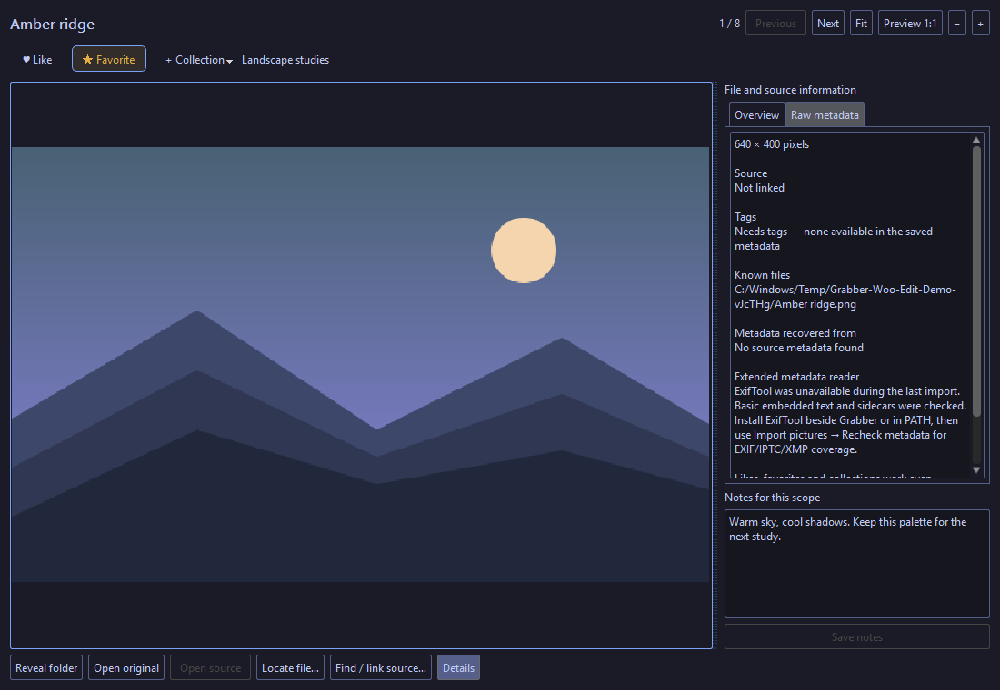

<p align="center"></p>

# Grabber Woo Edit

An all-in-one image searcher, downloader and personal picture Library. Search dozens of art sites at once, keep what you love, and get an endless **Discover** feed that learns from your likes and favorites.

[Download](https://github.com/SenjuWoo/imgbrd-grabber/releases/latest) · [Report an issue](https://github.com/SenjuWoo/imgbrd-grabber/issues) · [Upstream Grabber](https://github.com/Bionus/imgbrd-grabber) · [Apache 2.0 license](LICENSE)



*Discover with generated demo artwork. Pictures stay clean until you select one; then ♥ Like, ★ Favorite, Download and Not interested appear on it.*

## What's new in 7.21

- **Import a folder you love.** Library ▸ Import… ▸ *Choose folder of favorites* imports a folder and marks every picture ♥ Loved after you confirm the count, with **Undo**. Pictures that were already liked or favorited keep their rating.
- **Find sources for pictures without tags.** Import… ▸ *Find sources for pictures without tags* asks every source for the exact MD5 of each untagged import and lists the matches. Nothing is linked until you check a match and press **Link checked**, so Discover can finally learn from those pictures.
- **Reverse image search.** Find source has a **Reverse image search…** menu (SauceNAO, IQDB, Google Lens, Yandex, TinEye): it copies the picture to the clipboard and opens the site in your browser; you paste it there. Those sites block automated clients, so Grabber uploads nothing.
- **Mirrors are searched once.** danbooru.donmai.us, hijiribe, sonohara and shima are one server; having them all selected no longer sends every request three times. New profiles start with one of them. (Turn off with `skipMirrors=false` in settings.ini.)
- **Why this picture?** Right-click a Discover tile to see which search found it, which of your tastes it matches and how many of your pictures carry each tag.
- **Library health.** The **Health…** button lists missing files, pictures without a thumbnail, without tags, from a source you no longer use, duplicates and leftovers, and opens or removes the catalog entries.
- **Rate limits explained.** A 429 on any source shows "rule34.xxx is rate-limiting this search. Retrying in N seconds" instead of a bar that looks stuck.
- **rule34.xxx needs an API key now.** The error says where to get your user ID and key and where to enter them (Options ▸ Sources ▸ rule34.xxx ▸ Login, type URL).
- **Back up profile now** (Tools menu) saves a dated ZIP in the profile's `backups` folder and keeps the ten newest. Backups now include Discover's state (`discover.json`).
- **Fewer glitches.** Huge originals open in the viewer instead of being rejected at 256 MB. Discover's top-pick chips that do not fit are hidden instead of cut off.

## What's new in 7.20

- **Only exact duplicates are hidden.** Discover and merged searches drop the same picture from another site or re-encoded, and nothing else: edits, recolors, alternate versions and variants show up again. Of two copies, the one with **more tags** is the one shown and saved. Pictures already in your Library are matched the same strict way.
- **No repeats across pages.** Merged search remembers what earlier pages of the same search showed, so a copy from another site on page 3 no longer repeats a picture from page 1.
- **Copies of liked pictures show as liked** in search tiles and the viewer, not only once you like them again.
- **Tag adapter.** Names sources give the same theme (hidden_sex_toy and stealth_sex_toy, stealth_masturbation and secret_masturbation, netorare, ntr and cuckold, …) and other spellings (bodypaint, body_paint) count as one tag. Merged searches ask each source for all names in **one request** with its own OR syntax (rule34.xxx, rule34.us, gelbooru, safebooru, e621, konachan, yande.re); Discover searches each source under the name it uses.
- **No more guessed dislikes.** Discover no longer marks tags as avoided because they are rarer in your likes than on the site (solo, 1girl, looking_at_viewer, dialogue and the like). A tag is only avoided when you say so, or when several hidden pictures share it and none of your ratings has it.
- **Tune taste, clearer.** A **Neutral** choice drops a tag learned by mistake, each avoided tag says why, synonyms are listed once with their other names, the visual matching status is shown and **Hidden pictures** opens from the dialog.
- **Faster searches, no more rate-limit stalls.** Discover stops loading while you are on another page, so a search never waits behind it, and synonym searches no longer multiply requests.
- **Search tiles act like Discover.** Next to ♥, ★ and + there are ⤓ Download and ✕ Not interested (hide, see less of a tag, never see a tag, with Undo), also in the right-click menu. Hidden pictures and never-show tags apply to searches too.
- **62 per page everywhere.** rule34.xxx, rule34.us and gelbooru HTML pages hold 42 pictures; Grabber now loads two of them to fill a page.
- **Thumbnails.** Long comic-strip thumbnails load instead of showing a broken tile, failed thumbnails retry twice, and failures are logged. Merged results say how many pictures your blacklist, Hide liked or Not interested hid.
- **Find source asks all your sources.** Find exact match checks every selected source in turn instead of one. **Hidden pictures** also lists pictures hidden before 7.19 (as gray tiles) so each can be restored.
- **Safe updates.** The package marks portable mode with an empty `portable` file instead of a blank `settings.ini`, so extracting a new version over an install keeps your settings.

## What's new in 7.19

- **Your Library never comes back in Discover.** Pictures you already have are recognised by source, by file and by look, so copies from other sites, re-encodes and barely different variants stay out of the feed. A feed also shows only one picture of a set of variants.
- **No more duplicate Library entries.** Liking a copy of a picture you already have (another site, same file or same look) rates the one you have and remembers the new source. **Possible duplicates** gets **Merge all duplicates**, and **Merge into one picture** works on any selection.
- **Un-liking asks before keeping clutter.** When a picture is no longer liked, favorited, collected or annotated, Grabber offers to remove it from Library (you can make it remember). A **Not rated** view lists leftovers with **Remove all**.
- **Tell Discover what you are not into.** The ✕ button asks: hide just this picture, show less of one of its tags, or never show a tag again. **X** hides at once with **Undo**, and **Hidden pictures** brings back anything hidden by mistake.
- **Tune taste.** See what Discover learned and how it picks: strength of each tag, how many of your pictures carry it and how often its searches got rated. Set any tag to More, Less or Never, add **today's focus** tags, and choose **Familiar**, **Balanced** or **Adventurous**. Tooltips say why a picture was picked.
- **Find on Pixiv.** Find source reads a Pixiv file name (`123456_p5.jpg`), checks the artwork's public page and compares the original file byte for byte. No login needed.
- **Fixes.** Danbooru works again (its servers started refusing Grabber's old browser-style User-Agent, which broke listings and full-size files). Discover no longer trips rule34.xxx rate limits: it samples only sources it still needs to learn and sends at most two requests per source per batch.

## What's new in 7.18

- **Discover is the home page.** An endless, personal feed of *new* pictures from your selected sources. It searches with the real tags of what you like, favorites count three times as much as likes, recent ratings count a bit more, and every like, favorite or "Not interested" changes what comes next. Results stream in source by source and keep loading as you scroll.
- **Smart visual matching (optional local AI).** One click downloads an 89 MB image model; Discover then also ranks pictures that *look* like your favorites, even when tags differ. Everything runs on your PC, nothing is uploaded.
- **Your top picks.** Artists, characters and series you like most appear as chips at the top of Discover; one click opens a search.
- **A faster, cleaner Library.** One endless grid instead of pages, Select all, and a selection bar with Like, Favorite, Collection, **Download**, **Save to folder…**, Find source and Remove. **Download all** grabs every original in the current view. A new **Possible duplicates** view groups the same picture saved from different sources.
- **Search: Hide liked.** One checkbox hides pictures you already liked or favorited, including the same file from another site.
- **Merge results removes look-alike duplicates.** Besides identical checksums, merged results now recognise the same picture re-uploaded elsewhere (resized or recompressed). Strict thresholds keep edits, crops and recolors apart.
- **A modern shell.** A navigation rail (Discover, Search, Library, Following, Downloads, Monitors), search-only docks, the new **Woo Night** theme, rounded tiles that fill the window and toast confirmations. Keyboard: **L** like, **F** favorite, **D** download, **X** not interested, **Enter** open.
- **Ready-made defaults for new installs.** A curated set of sources and a source preset, a strong blacklist, 62 pictures per page, original-file downloads named by checksum with a comma-separated tag `.txt` beside each (ready for LoRA captions), merged results and hidden blacklisted posts. Existing profiles keep all their settings.

## Discover

Open **Discover** (it is also where Grabber starts). Like ♥ or favorite ★ anything you enjoy — in Discover, search results, the viewer or Library — and the feed adapts:

- Queries come from your actual saved tags, weighted by how often and how strongly you rated them, and paired with tags that appear together in your favorites so searches stay specific. Overly common tags (like `1girl` or `highres`) are down-weighted.
- Each source's results are filtered (blacklist, already rated, already shown, hidden), de-duplicated by checksum and by appearance, ranked, and streamed in. Only the best share reaches the screen.
- Pictures already in your Library never show up: not the same post, not the same file from another site and not the same picture re-encoded. Edits and variants are different pictures and do show up.
- Synonyms and other spellings of a tag count as one taste, searched under the name each source uses. Nothing is avoided by guesswork: only tags you turned down, or that several hidden pictures share while none of your ratings has them.
- **Not interested** (✕) asks what is wrong: hide only this picture, show less of one of its tags, or never show a tag. **X** hides at once; the toast has **Undo**, and *⋯ → Hidden pictures* restores any hidden picture later.
- **Tune taste** shows what Discover learned, how strongly, why a tag is avoided and how well each search worked. Set tags to More, Neutral, Less or Never, add today's focus tags, and choose Familiar, Balanced or Adventurous. Hover a picture to see which of your tastes it matches. Search tiles have the same ✕ Not interested.
- Choose **Everything I love** or a single collection's taste. Collections keep their own likes and favorites.
- With no ratings yet, Discover shows fresh posts from your sources until you rate a few.

Turn on **Smart visual matching** from the banner or *⋯*. The model is verified by size and SHA-256, the image index updates in the background, and Discover blends tag and visual similarity. Status and coverage are shown in the menu, and the log notes for every batch how many pictures were ranked by look.

## Library



*Generated demo artwork imported from local files into a collection with its own likes and favorites.*

- **Like, Favorite and Collection** actions work in Discover, search thumbnails, the viewer, context menus and Library. Like and Favorite are exclusive per scope.
- **Collections have independent preferences.** A picture can belong to several collections, each with its own likes, favorites and notes.
- **Import existing downloads** by choosing files or folders, or dropping them on Library. Reference originals or keep managed copies; SHA-256 identifies exact duplicates.
- **Download / Save to folder.** Download fetches originals into your usual folder; Save to folder copies files already on disk and downloads the rest into a folder you pick.
- **Smart views:** Unsorted, Liked, Favorites, Recently saved, Needs tags, Needs source, Metadata errors and Possible duplicates.
- **Find or link a source** using recovered URLs, an exact MD5 query, or visual comparison against pictures already in Library.



Existing tag bookmarks remain available under **Following**, including monitors. Removing a Library entry or collection leaves original downloads on disk.

## Download and start

The primary release is a **portable Windows x64 ZIP** for Windows 10 or 11. Qt, OpenSSL, image plugins, SQLite, source scripts, themes, defaults and translations are bundled.

1. Download the Windows ZIP from [Releases](https://github.com/SenjuWoo/imgbrd-grabber/releases/latest).
2. Extract it into a writable folder and run `Grabber.exe`.
3. Pick a download folder in the first-launch window (or keep the recommended sources), then like a few pictures and open **Discover**.

For an existing portable install, close the app and back up its profile first. Preserve `settings.ini`, per-site settings/cookies, saved searches, history, blacklists, tabs, queues, `library.sqlite`, `library-media`, `discover.json`, `models/`, `recommendations/` and other personal files. Replace the runtime with a clean package instead of mixing Qt DLL generations. See [maintenance](docs/woo-maintenance.md).

The display name is **Grabber Woo Edit**. Executable names and profile identifiers are retained so updates never move or reset your data.

## Imported pictures and missing metadata

The Library grid shows every picture in one scrollable view; search and filters cover the entire Library.

- **Needs tags** lists pictures without usable tags. A successful import does not imply that tags were present in the file.
- **Needs source** lists pictures without an identified website post, including pictures whose file tags were recovered.
- **Metadata errors** lists reader failures separately from absent metadata. Open a picture's Overview for the reason.

Select one picture and click **Find source…** in the selection bar. Choose a source for exact MD5 lookup, or compare pictures already cached in Library, then confirm a candidate to attach its post metadata. **Import… → Recheck metadata** retries local files without duplicating pictures or resetting ratings. Likes, favorites, notes and collections work without tags and are kept when a source is linked. Optional [ExifTool](https://exiftool.org/install.html) extends EXIF/IPTC/XMP coverage.

## Online sources and current limits

The upstream downloader features remain: multiple tabs and sources, tag autocomplete, blacklists, filters, filename tokens, authentication, batch downloads, monitors and CLI commands. Sources include Danbooru, Gelbooru, Rule34, e621, Sankaku, Pixiv, Reddit, Kemono, Zerochan and more. Website availability and account requirements vary; some sites sit behind Cloudflare challenges or need API keys, and Discover reports sources that did not respond.

- **Pixiv** requires authentication. **Reddit** searches keywords, authors, subreddits and flair rather than booru tags.
- Discover searches the sources you selected in a search tab. Tag vocabularies differ between sites, so general tags are searched on sites where you rated them or whose sampled posts carry them (under any of their names); artists, characters and series can be searched anywhere.
- Visual matching compares previews against your own rated pictures. It does not perform Internet-wide reverse searches or upload files.

The Library stores its catalog and bounded previews locally. Fresh profiles have usage analytics disabled by default. Built-in backups include the catalog and managed copies; externally referenced originals need their own backup. Android uses a separate QML UI without these features.

## Build and verify

Use Qt 6, CMake, Ninja, Node.js, OpenSSL, and a C++17 compiler. Windows builds use MSVC. CI pins Qt **6.11.3**, Windows OpenSSL **3.5.9 LTS**, and the repository's exact source submodule revisions. The HTML parser is Lexbor **3.0.0**.

```powershell
# Windows: discover SDKs from QT_ROOT_DIR / OPENSSL_ROOT_DIR or the CMake cache.
powershell -NoProfile -ExecutionPolicy Bypass -File scripts/build-local.ps1
```

```sh
git submodule update --init --recursive
cd src/sites
npm ci
npm run build
npm run check
npm audit --audit-level=moderate
npm test -- --runInBand
```

`build-local.ps1` builds the GUI/CLI, runs the existing C++ and site tests, and stages a clean portable package with a commit and per-file hash manifest. Linux/macOS build instructions remain in the [upstream documentation](https://www.bionus.org/imgbrd-grabber/docs/compilation.html). The [Build workflow](.github/workflows/build.yml) checks Windows, Linux, macOS, Android, formatting, coverage, and site adapters. Published artifacts must come from the same commit whose required checks succeeded.

## Changes in 7.21.6

- **A rejected search now says why, and stops.** Danbooru answers a three-tag anonymous search with HTTP 422 and "You cannot search for more than 2 tags at a time."; the app used to spend the XML, JSON **and** HTML endpoints on it and then report "No valid source of the site returned result". The site's own message is shown, and the remaining APIs are skipped because they would answer the same.
- Same handling for any search the site refuses on every format (invalid syntax, tag limit): one request, one clear error.

## Changes in 7.21.5

- **A failed video no longer turns into a still image.** When the video file failed to download, extension rotation could fall back to `jpg`/`png`, and sites answer that URL with the thumbnail, so the retry "succeeded" and saved a JPEG in place of the video. Videos now only rotate between video formats.
- A filename condition on an empty tag (`<"">`) no longer dereferences a null filter and crash while expanding filenames.
- Setting a favorite's thumbnail no longer reuses the first picture of whatever search ran last; it only uses a picture that actually carries the favorite's tag.
- The Log tab keeps the last 5000 lines and no longer records undo history, so a long download run stays responsive instead of re-laying out an ever-growing document.
- Batch download no longer pumps the event loop before starting the next file, which could start it before the current save had returned.

## Changes in 7.21.4

- **No usage reporting.** Earlier builds still carried the upstream project's Google Analytics IDs, and a profile with `send_usage_data=true` (Options ▸ Send usage data) sent the sources it loaded pages from to Google. Woo Edit now never sends it, whatever the profile says; the Options box is off and greyed out.
- Danbooru's XML source no longer throws when the server answers with a wall or error page; it reports the page as unusable instead of the uncaught `Cannot read property 'post' of undefined`.
- Opening a picture whose thumbnail never loaded, and the Find source dialog without a stored thumbnail, no longer log `QPixmap::scaled: Pixmap is a null pixmap`.

## Changes in 7.21.3

- Paheal (rule34.paheal.net) returns images again: the site changed its thumbnail markup (dimensions separated by a space instead of ` // `, no `width`/`height` attributes, previews served from its CDN), so every paheal result parsed as zero images and searches silently lost that source. The parser accepts both the old and the new markup, so paheal contributes to every search again.

## Changes in 7.21.2

- Searches search exactly the tags you type, on every source: two tags always mean **both**. The synonym expansion (typing `buttplug` also searched `anal_plug` and `butt_plug`, so results included pictures without the tag you searched) is gone.
- No more stacked rate-limit waits: while one request of a site is waiting out a 429, another page of that site fails right away instead of adding its own 5 s + 15 s retry chain and freezing the search ~20 s longer.
- Discover leaves a source that just failed (rate limit, wall, outage) alone for 5 minutes instead of retrying it every batch; searches find sources responsive again sooner.
- Discover marks shown pictures as "seen" only when the next batch is fetched (scroll to load more or Refresh), so a batch that was loaded but not looked through keeps its place in the **Show again after** window.

## Changes in 7.21.1

- Discover no longer repeats a picture for **Show again after** hours (Tune taste…, default 48, 0 = never repeat). Until now it remembered only the last 4000 pictures, which a day of browsing used up; times are kept per picture and the same file from another source counts as seen.
- Searches stop hanging on rate limits: a 429 is retried inside that search after 5 s, then 15 s, instead of waiting in the site's shared 60 s retry queue behind every earlier retry (including cancelled Discover ones).
- Search tiles open with a double click, like Discover and the Library. A plain click only focuses the tile; Ctrl+click still selects.

## Changes in 7.21.0

- Library: import a folder as ♥ Loved (confirmed count, Undo); batch exact-MD5 source lookup for untagged imports with review before linking; **Health…** report (missing files, no thumbnail, no tags, unknown source, metadata errors, duplicates, not rated) with open and catalog-only removal; Find source gets a reverse-image-search menu that copies the picture and opens the site in the browser (no upload by Grabber).
- Sources that serve one database (danbooru, hijiribe, sonohara, shima) are searched once in Search and Discover; the defaults list only danbooru.donmai.us.
- Discover: **Why this picture?** explains the search, matching tastes and tag counts of a tile. Top-pick chips that do not fit are hidden.
- A 429/503 shows a rate-limit notice with the retry delay. Gelbooru-style "Missing authentication" (rule34.xxx API) says where to enter the API key. Qt's 256 MB image allocation limit raised to 1 GB.
- Backups include `discover.json`; **Tools ▸ Back up profile now** keeps the ten newest dated ZIPs.
- The Library open logs how long its integrity check took (45 ms for a 100 MB Library: startup time is elsewhere).

## Changes in 7.20.0

- Discover, merged search and Library matching hide exact duplicates only (same post, checksum or strict look); the 7.19 variant matching is removed. Merged search remembers checksums and looks per page of a search and drops repeats on later pages. Library actions show the rating of a matching Library picture for re-encoded copies.
- Taste profile: no negative weights from lower-than-background frequency or from absence; plain hides only count for tags absent from every rating and shared by two or more hidden pictures; aspect-ratio and `_(artwork)` tags are meta. Verified synonym groups plus separator-only spellings share weights, are listed once, and are searched under each source's own name; Discover may search a tag on sources whose samples carry it. New **Neutral** preference.
- Merged search sends the other names of one typed tag in the same request with the source's OR syntax (`( a ~ b )` rule34.xxx/safebooru, `{a ~ b}` gelbooru/rule34.us, `~a ~b` e621/Moebooru, Danbooru only within its two-tag limit); other sources get the search as typed (tag adapter). Of duplicate copies the better tagged one stays. Search tiles get Download and Not interested; Not interested and never-show tags apply to searches.
- Discover pauses while hidden and aborts its running batch, so searches do not queue behind it on rate-limited sources; each batch logs how many pictures the local model ranked. Hidden pictures lists legacy entries without previews. Find source checks all selected sources in turn.
- Portable packages ship an empty `portable` marker instead of a blank `settings.ini`.
- Fixed-size sources (`forcedLimit`) join consecutive source pages to fill larger pages; a failed follow-up request keeps the pictures already found. rule34.us pages hold 42 pictures. Discover samples 42 newest posts per request.
- Thumbnails up to 30000 px tall load; transient failures retry after 1 s and 4 s; final failures are logged.

## Changes in 7.19.0

- Recognise Library pictures in Discover by source link, file checksum and a background visual index of Library thumbnails; skip variants within a feed and of Library pictures.
- Join copies of Library pictures on save (same checksum, or same look for pictures saved from a site) as source links instead of new entries; resolve same-checksum copies everywhere ratings are shown. Add duplicate groups with a best-copy choice, **Merge all duplicates**, **Merge into one picture**, a **Not rated** view and an opt-out prompt to remove pictures that are no longer rated.
- Discover: per-tag More/Less/Never, today's focus, variety, "Matches your taste" tooltips, a **Tune taste** dialog with learned strengths and search hit rates, a **Not interested** menu with tag choices, quick hide with Undo, and restorable hidden pictures (kept with their details in `discover.json`).
- Search **Hide liked** also hides re-encoded copies of liked pictures.
- **Find on Pixiv** in Find source: artwork ID from file names or URLs, public artwork details without login, original file compared by MD5.
- Danbooru: use a plain `Grabber/<version>` User-Agent; the Firefox-style one is now refused (HTTP 403) for listings and files.
- Discover samples newest posts only on sources it still needs to learn and sends at most two page requests per source per batch, avoiding rule34.xxx HTTP 429.

## Changes in 7.18.0

- Make **Discover** the home page: an endless personal feed from selected sources, learned from tag weights of likes (1×) and favorites (3×) with recency, co-occurring tag pairs, per-site vocabularies, persistent "Not interested" feedback, seen-history, blacklist and rating filters, checksum and visual de-duplication, per-source streaming and bounded timeouts.
- Use the local CLIP model where it helps: rank Discover candidates by visual similarity to rated pictures on a background thread. Add "Your top picks" chips and "More like this".
- Rebuild Library on a shared picture grid: no pages, Select all, selection bar, Download, Download all, Save to folder, Possible duplicates, in-place rating updates that keep scroll and selection.
- Search: add **Hide liked** and visual duplicate merging (including same-site reposts) to Merge results; hidden duplicates no longer leave gaps.
- Add the navigation rail, search-only docks, Woo Night theme, toasts and keyboard actions. Discover opens first unless Grabber was started for a specific search.
- Ship first-run defaults (sources, presets, blacklist, naming) for new profiles only; install every bundled theme.
- Fix the scroll range ending early on large grids by laying tiles out in a single pass.
- Make Discover learn what sets a taste apart: it samples newest posts on rated sources to see how common each tag is there, weighs rated tags by how much more often they appear in ratings (themes, artists and characters over breasts and ass), searches the strongest tags, and favors searches whose pictures get liked while dropping ignored or hidden ones.
- Ship a stronger default blacklist: male-only, gay, trap, futanari, scat and diaper content, while pictures of women with a man or penis in the background stay visible. New profiles show 62 pictures per page and write a `.txt` of comma-separated tags next to each download (ready for LoRA captions).
- Fix Discover double-click not opening the viewer; retry momentary download and thumbnail failures; read the real file address from the post page when a guessed one is missing (rule34.xxx HTML listings); time out stalled hosts after 30 s of silence so searches finish; tighter, centered search result grid.
- Remove unused miniz file I/O and use `localtime_r`; keep never-built vendored generators and test frameworks out of code scanning.

## Changes in 7.17.1

- Add opt-in online Home discovery from existing selected sources, with scoped weighted tag topics, refresh rotation, bounded requests, cancellation, clear failures and explicit saving.
- Diversify local saved recommendations across interests while keeping collection preferences independent.
- Make Like and Favorite exclusive, including source merges and legacy catalog restoration; preserve a backup before correcting old overlapping ratings.
- Add image-only grids, shared density controls and Library page sizes; show actions after selecting a picture. Render cached/missing previews consistently, preserve aspect ratios, bound decoding and retry real thumbnail alternatives.
- Merge only exact checksums or identical full URLs without checksums; preserve edits, variants, uncertain matches and stable viewer bindings.
- Fix source-limit paging, estimated-total cutoffs, cursor isolation, batch progress, failed-source handling and truthful visible counts.
- Update the site test tooling's transitive Handlebars dependency to the security-patched 4.7.10 release.

## Changes in 7.16.0

- Add Home with local visual recommendations, independent collection taste, daily selection, recent saves, scoped hiding and shared image actions.
- Ship a verified CPU runtime; stream and verify the frozen CLIP model, index previews in a cancellable background job, and reuse vectors only for unchanged thumbnails/model identity.
- Preserve missing metadata labels and explain tagless ratings/index coverage. Keep explicit collection membership and viewer preference scope visible.
- Restore Home sessions and target the actual current search widget after tabs are moved. Finalize local AI work before destroying the profile on every application exit path.
- Add native UI, ranking, preprocessing/cache tests and real portable inference/reuse/corrupt-model CI checks.

## Changes in 7.15.4

- Rename the product to Grabber Woo Edit while preserving profile compatibility and historical attribution.
- Ship the desktop Library, collections, likes/favorites, scoped notes, covers, local imports, offline viewer, metadata recovery, and explicit source linking developed in the previous local milestones.
- Add a reference import command for automation: `Grabber-cli.exe --import-library "path/to/file-or-folder"`; it reuses the Library importer, preserves preferences, and reports errors as JSON.
- Add explicit gallery pagination, metadata review views, a visible source-link action, and safe metadata rechecks. Very large images remain in Library with metadata and ratings even when a preview cannot be decoded within the memory limit; use Open file to view their originals externally.
- Repair Reddit cursor pagination, author searches, empty subreddit listings, and crosspost media; handle Pixiv error and incomplete responses.
- Update Qt, Windows OpenSSL, Lexbor, and compatible Jest/ts-jest dependencies. Add the npm audit and Windows GUI test gates; use supported Node.js for source builds.
- Repair HTML document/selector ownership, release temporary serialization buffers, preserve UTF-8 byte lengths, and keep child nodes valid after their original wrapper closes.
- Distinguish failed update checks from an up-to-date result and retain legacy version comparisons.
- Repair fresh MSVC stable-build debug information; check generated flags before compiling.
- Deploy QScintilla's Qt PrintSupport dependency explicitly in portable Windows packages, including builds without the browser engine.
- Keep CLI initialization independent of the browser engine and test the extracted Windows package before uploading it.
- Keep prior download queue, bounded redirects/retries, save failure, ZIP validation, transactional database, conversion, theme, and translation repairs.

## Provenance

This fork is maintained in [SenjuWoo/imgbrd-grabber](https://github.com/SenjuWoo/imgbrd-grabber), based on [Grabber by Bionus and contributors](https://github.com/Bionus/imgbrd-grabber). It includes earlier Fable fork contributions and current upstream `develop` changes. The Apache 2.0 license and third-party notices remain intact. The screenshots show generated sample artwork, not a user's private Library.

Support the original author: [PayPal](https://www.paypal.me/jvasti) · [Patreon](https://www.patreon.com/bionus). Fork-specific bug reports belong in this repository; upstream contributions remain welcome.
